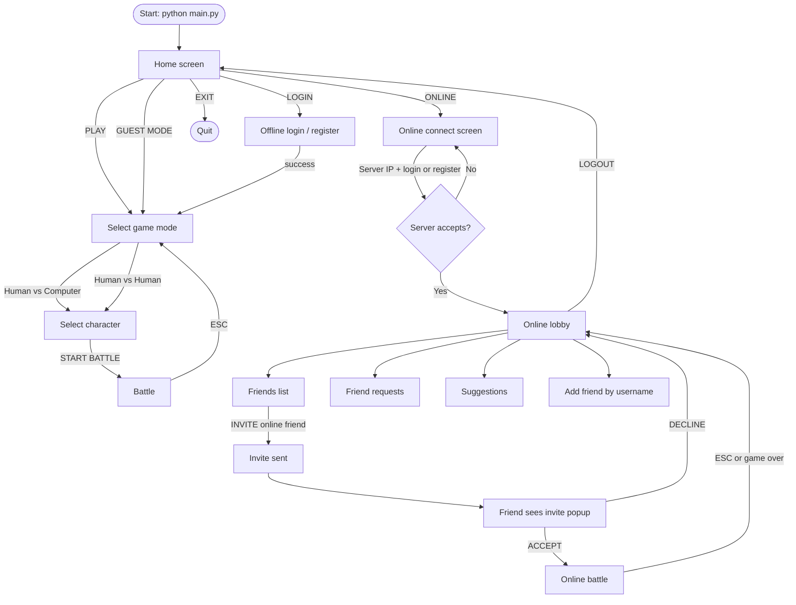
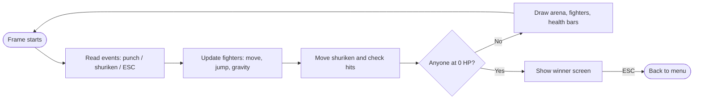
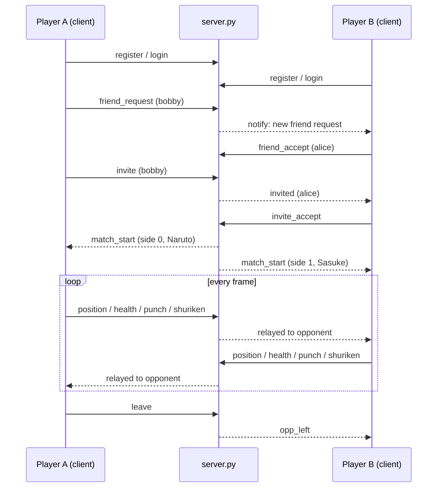

<p align="center">
  
</p>

# 🍥 Naruto vs Sasuke

A 2D fighting game made with **Python and Pygame**. Pick Naruto or Sasuke, fight the computer or a friend, and play **online over WiFi** with accounts, a friends list, friend suggestions and battle invites.

> Fan-made, non-commercial project. Naruto and Sasuke belong to Masashi Kishimoto / Shueisha / Studio Pierrot. No affiliation or endorsement.

---

## ✨ Features

-  **Human vs Computer**: fight a simple AI that walks, jumps, punches and throws shuriken
-  **Human vs Human**: two players on one keyboard
-  **Online battles**: each player on their own PC, connected through a small server
-  **Accounts**: register and login with salted + hashed passwords (PBKDF2-SHA256)
-  **Friends system**: send, accept and reject friend requests
-  **Friend suggestions**: people you recently fought come first, then other players
- **Battle invites**: invite an online friend and they get a popup to accept or decline

---

## 📸 Screenshots

| Home | Mode select |
|:---:|:---:|
|  |  |

| Battle | Winner screen |
|:---:|:---:|
|  |  |

---

## 🚀 Quick start

**Requirements:** Python 3.10+ and Pygame.

```bash
pip install pygame
python main.py
```

Choose **PLAY** (offline) or **GUEST MODE** to start fighting right away.

---

## 🎮 Controls

| Action | Offline P1 / Online | Offline P2 (Human vs Human) |
|---|---|---|
| Move | `←` `→` | `A` `D` |
| Jump | `↑` | `W` |
| Punch | `G` | `Q` |
| Shuriken | `F` | `E` |
| Leave / back | `ESC` | `ESC` |

Punch deals **10** damage and has knockback. Shuriken deals **12** damage. First fighter to reach 0 HP loses.

---

## 🗺️ Game flow



### Inside a battle



---

## 🌐 Playing online (same WiFi)

### 1. Start the server (on one PC)

```bash
python server.py
```

It prints something like:

```
Same PC:      127.0.0.1
Same WiFi:    192.168.1.7   (give this IP to your friend)
Port:         5555
```

> The first time, Windows Firewall will ask for permission. Click **Allow**, otherwise your friend cannot connect.

### 2. Connect each player

1. Run `python main.py` on each PC and click **ONLINE**.
2. Type the **Server IP**: `127.0.0.1` if the server runs on the same PC, otherwise the `Same WiFi` IP the server printed. Use the **IPv4** address only, not the long IPv6 one.
3. Enter a username and password, then click **REGISTER** (first time) or **LOGIN**.

### 3. Add a friend and fight

1. In the lobby, click **ADD** next to a suggestion, or type a username at the bottom.
2. The other player accepts under **REQUESTS**.
3. When your friend shows a green dot, click **INVITE**.
4. They click **ACCEPT** on the popup and the battle starts. The inviter plays **Naruto** and the other player plays **Sasuke**.

### Testing alone

Start the server, then open `main.py` in two windows, both with IP `127.0.0.1`. Register two different accounts.

### How it works



- Messages are **JSON lines over TCP** (port `5555`).
- The server stores accounts, friends and match history in SQLite and relays battle messages.
- Each player moves their own fighter. The player who gets hit subtracts their own health.

> ⚠️ This design is fine for playing with friends but is **not cheat-proof**.

---

## 📁 Project structure

```
.
├── main.py             # Menus, login, online lobby, game loop
├── battle.py           # Offline battle: Fighter, Shuriken, AI
├── online_battle.py    # Online battle (state sync over the network)
├── network.py          # Client networking (background reader thread)
├── server.py           # Game server: auth, friends, invites, relay
├── database.py         # SQLite: users, friends, requests, matches
├── assets/             # Sprites, background, shuriken
├── screenshots/        # Images used in this README
└── game_accounts.db    # Created automatically (not committed)
```

### Assets used by the code

| File | Purpose |
|---|---|
| `bg.jpg` | Background for menus and arena |
| `shur.jpg` | Shuriken image |
| `Nstanding.jpg`, `NR2.jpg`, `NR3.jpg`, `NL2.jpg`, `NL3.jpg` | Naruto sprites |
| `Sstanding.jpg`, `SR1.jpg`, `SR2.jpg`, `SL2.jpg`, `SL3.jpg` | Sasuke sprites |

Sprites are JPGs, so near-white pixels are removed at load time to fake transparency. Transparent PNGs would look cleaner and load faster.

---

## 🛠️ Troubleshooting

| Problem | Fix |
|---|---|
| `No module named 'database'` | File names must be lowercase: `database.py`, `network.py`, `online_battle.py`, `server.py` |
| `Missing sprite file(s)` | Check the file names listed under *Assets* are inside `assets/` |
| Cannot reach server | Same WiFi? `server.py` running? Firewall allowed? IPv4 typed correctly? |
| Phone hotspot will not connect | Some hotspots block device-to-device traffic. Try a normal WiFi router |
| Character faces the wrong way when standing | Toggle `FLIP_STANDING_WHEN_LEFT` at the top of `battle.py` |

---

## 🔮 Ideas for the future

- Online play over the internet (host `server.py` on a cloud service)
- Touch controls for phones
- More characters, special moves and chakra bar
- Transparent PNG sprites and sound effects
- Server-side hit detection to prevent cheating

---

## 👩‍💻 Author

Made by **Jiya Batra**. Built with Python and Pygame.
